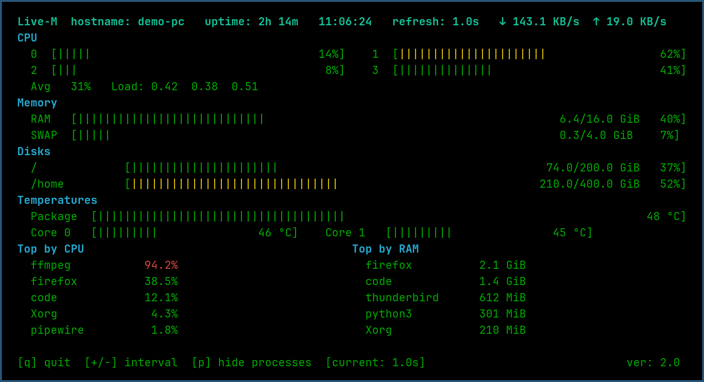

# Live-M

Lightweight CLI system monitor — lightweight replacement for htop + psensors.

[](https://www.linux.org/)
[](https://www.python.org/downloads/)
[](https://opensource.org/license/MIT)
[](https://github.com/Icenux/Live-M)



## What it shows

- **CPU** — per-core usage bars with color coding (2-column on wide terminals) + average + load average (1/5/15 min)
- **RAM & SWAP** — usage bars with used/total in GiB and percentage
- **Disks** — usage bars for all real mountpoints (skips tmpfs, snap, /boot)
- **Temperatures** — CPU package (full-width bar) + per-core bars; other detected sensors
- **Wi-Fi** — live ↓/↑ speed shown in the header (the wireless interface is detected from the kernel, whatever it is named)
- **Top processes** *(optional, off by default)* — the 5 busiest processes by CPU and by RAM; press `p` to show them

All panels update live. There is no full process list — that's why it's lighter than htop. The top-processes panel is opt-in and sampled slowly (see [Why not htop?](#why-not-htop)).

## Requirements

- Linux, any distribution (pure Python on `/proc` and `/sys`, so not tied to a CPU architecture;
  ready-made packages exist for Debian / Ubuntu / Mint and Arch)
- Python 3.10+ (Ubuntu 22.04 / Mint 21 and newer; Arch ships the latest)
- python3-psutil

## Installation

From the Icenux package repository (Debian / Ubuntu / Mint) — later versions then arrive with `apt upgrade`:

```bash
sudo curl -fsSL https://icenux.github.io/icenux/icenux.asc -o /usr/share/keyrings/icenux.asc
echo 'deb [signed-by=/usr/share/keyrings/icenux.asc] https://icenux.github.io/icenux/apt ./' \
  | sudo tee /etc/apt/sources.list.d/icenux.list
sudo apt update && sudo apt install livem
```

On Arch Linux, install the package from the [latest release](https://github.com/Icenux/Live-M/releases/latest):

```bash
sudo pacman -U livem-X.Y.Z-1-any.pkg.tar.zst
```

From source:

```bash
git clone https://github.com/Icenux/Live-M.git && cd Live-M
pip install .          # or run without installing: PYTHONPATH=src python3 -m livem
```

## Usage

```bash
livem
```

| Key | Action |
|-----|--------|
| `q` / `Ctrl+C` | Quit |
| `+` | Increase refresh interval |
| `-` | Decrease refresh interval |
| `p` | Show / hide the top-processes panel |

Optional flags:

```bash
livem --interval 2    # refresh every 2 seconds
livem --procs         # start with the top-processes panel on
livem --no-color      # disable colors
livem --version
livem --help
```

## Why not htop?

htop iterates over all processes in `/proc/[pid]/` on every refresh. Live-M skips processes by default, so its CPU usage stays around 0.4 % of one core.

When you do want to know *what* is loading the machine, press `p`. The top-processes panel keeps the cost low:

- it is **off by default** and sampled **only while it is on screen** — hide it and the cost is zero again;
- it reads just one small file per process (`/proc/<pid>/stat`), not full psutil process objects;
- it samples every 3 seconds, independently of the screen refresh;
- it is not shown when the terminal is too small for it, and then it is not sampled either.

Measured on a 300-process machine (1 s refresh, 30 s average): about **0.4 %** of one core without the panel and about **0.8 %** with it.

## Development

```bash
PYTHONPATH=src python3 -m unittest discover -s tests -v   # unit tests (process sampler)
PYTHONPATH=src python3 -m livem                           # run from source
python3 tools/make_screenshot.py                          # regenerate docs/screenshot.png
```

The screenshot is rendered from **fake demo data** (needs `tmux`, Pillow and the JetBrainsMono Nerd Font), so no real host information ends up in the repository.
